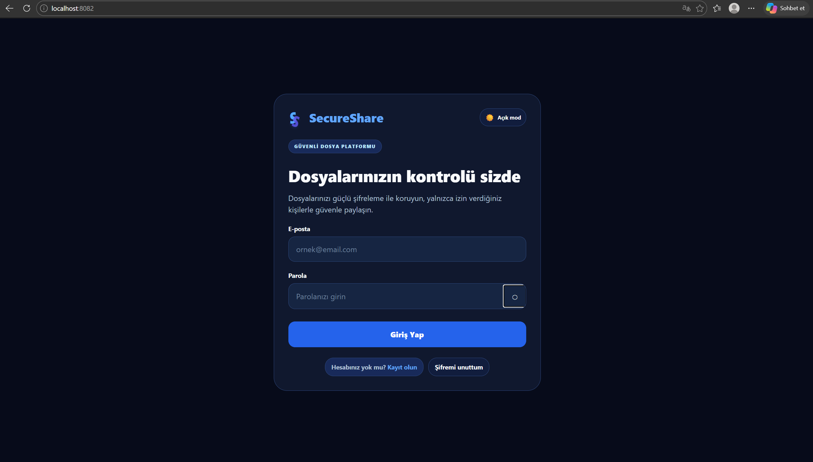
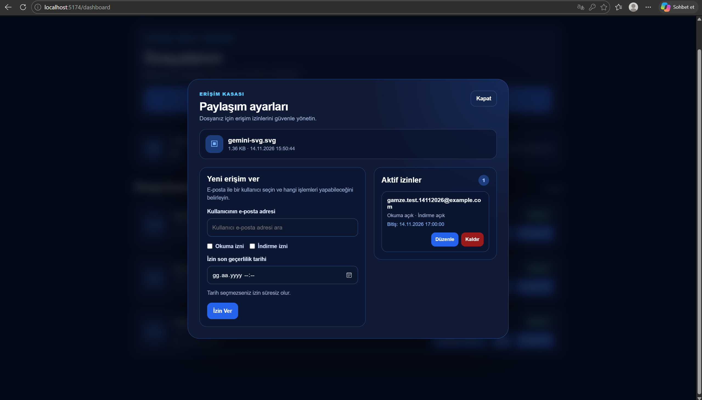

# SecureShare





SecureShare; dosyaları şifreleyerek saklayan ve yalnızca yetkili kullanıcılarla paylaşan güvenli dosya paylaşım uygulamasıdır. Web ve mobil istemciler yalnızca REST API ile haberleşir; PostgreSQL, MinIO ve anahtar malzemesi istemcilere açılmaz.

> Bu proje eğitim ve akademik geliştirme amacıyla hazırlanmıştır. Canlı ortamda TLS, anahtar rotasyonu, oran sınırlama ve merkezi sır yönetimi gibi ek kontroller gerekir.

## Özellikler

| Alan | Durum | Açıklama |
|---|---|---|
| Kayıt ve giriş | Tamamlandı | Argon2id parola hashleme ve JWT oturumu |
| Dosya şifreleme | Tamamlandı | AES-128-GCM, dosya başına DEK ve KEK ile zarf şifreleme |
| Güvenli depolama | Tamamlandı | MinIO'ya yalnızca şifreli veri yazılır |
| Dosya yükleme ve listeleme | Tamamlandı | Web ve mobil istemcilerden REST API üzerinden |
| Okuma ve indirme izinleri | Tamamlandı | Süreli veya süresiz READ ve DOWNLOAD izni |
| Paylaşım yönetimi | Tamamlandı | Dosya sahibi izin verebilir, güncelleyebilir ve kaldırabilir |
| Güvenli önizleme | Tamamlandı | Okuma izni olan kullanıcı PDF ve görselleri görüntüleyebilir |
| Audit log | Tamamlandı | Dosya erişimi ve izin işlemleri için hash bağlı kayıtlar |
| Web istemcisi | Tamamlandı | React + Vite |
| Mobil istemci | Tamamlandı | React Native + Expo |

## Güvenlik modeli

- Parolalar Argon2id ile hashlenir; düz metin parola saklanmaz.
- Her dosya AES-128-GCM ile ayrı bir DEK kullanılarak şifrelenir.
- DEK, `KEK_HEX` ile sarılır; şifreli dosya MinIO'da, metadata ve sarılmış DEK PostgreSQL'de tutulur.
- İstemciler MinIO, PostgreSQL, KEK, DEK veya JWT sunucu sırrına doğrudan erişmez.
- Dosya sahibi paylaşım ve silme işlemlerini yönetir.
- READ izni dosyayı güvenli önizlemede açar; DOWNLOAD izni ayrıca dosyayı indirmeyi sağlar.
- İznin geçerlilik tarihi dolduğunda dosya erişimi otomatik olarak engellenir.

## Mimari

```text
React web / React Native + Expo
              |
              | REST API + JWT
              v
        Node.js + Express
           |            |
           v            v
     PostgreSQL        MinIO
  (metadata, izin,   (yalnızca
    audit log)      şifreli nesne)
```

## Teknolojiler

| Katman | Teknoloji |
|---|---|
| Web | React, Vite, Axios |
| Mobil | React Native, Expo, SecureStore, DocumentPicker |
| Backend | Node.js, Express |
| Veritabanı | PostgreSQL 16 |
| Nesne depolama | MinIO (S3 uyumlu) |
| Kimlik doğrulama | JWT, Argon2id |
| Şifreleme | AES-128-GCM, DEK/KEK |
| Denetim kaydı | PostgreSQL hash bağlı audit log |

## Proje yapısı

```text
SecureShare/
├── backend/       # Node.js REST API, şifreleme ve MinIO katmanı
├── web/           # React + Vite web istemcisi
├── mobile/        # React Native + Expo mobil istemcisi
├── docs/          # Şema, entegrasyon ve test notları
├── docker-compose.yml
├── .env.example
└── README.md
```

## Gereksinimler

- Git
- Node.js 18 veya üzeri
- Docker Desktop
- PowerShell (Windows kurulumu için)

## Yerel kurulum

### 1. Ortam değişkenleri

```powershell
git clone https://github.com/GamzeNurAslan/SecureShare.git
cd SecureShare
Copy-Item .env.example .env
```

`.env` dosyası yereldir; Git'e eklenmemelidir. `JWT_SECRET`, `KEK_HEX` ve `MINIO_ROOT_PASSWORD` için güçlü değerler belirleyin.

128 bit KEK üretmek için:

```powershell
node -e "console.log(require('crypto').randomBytes(16).toString('hex'))"
```

Üretilen 32 karakterlik hex değeri `KEK_HEX` değişkenine yazın.

### 2. PostgreSQL ve MinIO

```powershell
docker compose up -d
docker compose ps
docker exec secureshare-postgres pg_isready -U secureshare -d secureshare
```

Yeni bir veritabanında şemayı uygulamak için:

```powershell
Get-Content -Raw docs/database/schema.sql |
  docker exec -i secureshare-postgres psql -U secureshare -d secureshare
```

### 3. Backend

```powershell
cd backend
npm install
npm test
node server.js
```

Örnek `.env.example`, API'yi `http://localhost:3001` adresinde başlatır. Sağlık kontrolleri:

```powershell
Invoke-RestMethod http://localhost:3001/health
Invoke-RestMethod http://localhost:3001/health/db
```

### 4. Web istemcisi

Yeni bir terminalde:

```powershell
cd web
npm install
npm run dev
```

Vite'ın terminalde verdiği adresi açın. Farklı bir API adresi kullanmak için `VITE_API_URL` ortam değişkeni tanımlanabilir.

### 5. Mobil istemci

Yeni bir terminalde:

```powershell
cd mobile
npm install
npm run web
```

Fiziksel telefonla testte `localhost` telefonun kendisini gösterir. Bu durumda `mobile/App.tsx` içindeki API adresini bilgisayarın yerel IP adresiyle değiştirin ve backend'i ağdan erişilebilen bir adreste çalıştırın.

## REST API

Tüm `/api/files` uçları JWT gerektirir.

| Method | Uç | Açıklama |
|---|---|---|
| GET | `/health` | Backend sağlık kontrolü |
| GET | `/health/db` | PostgreSQL bağlantı kontrolü |
| POST | `/api/auth/register` | Kullanıcı kaydı ve JWT üretimi |
| POST | `/api/auth/login` | Kullanıcı girişi ve JWT üretimi |
| GET | `/api/files` | Sahip olunan veya paylaşılan dosyaları listeler |
| POST | `/api/files` | Dosyayı şifreleyip MinIO'ya yükler |
| GET | `/api/files/:id/view` | READ izniyle güvenli önizleme |
| GET | `/api/files/:id` | DOWNLOAD izniyle dosya indirir |
| DELETE | `/api/files/:id` | Dosya sahibinin dosyayı silmesi |
| GET | `/api/files/users/search?q=` | Kayıtlı kullanıcı araması |
| GET | `/api/files/:id/permissions` | Dosya sahibinin izinleri görüntülemesi |
| POST | `/api/files/:id/permissions` | READ/DOWNLOAD izni verme veya güncelleme |
| DELETE | `/api/files/:id/permissions/:userId` | İzni kaldırma |

## Testler ve kalite kontrolleri

```powershell
# Backend
cd backend
npm test

# Web
cd ../web
npm run lint

# Mobil TypeScript kontrolü
cd ../mobile
npx tsc --noEmit
```

İstemci sınırı denetimi; web ve mobil uygulamaların yalnızca REST API ile haberleştiğini, sunucu sırlarına ve altyapı servislerine doğrudan erişmediğini doğrular. Ayrıntı için [client-api-boundary-report.md](docs/client-api-boundary-report.md) dosyasına bakın.

## Geliştirme notları

- `file_permissions` şeması gelecekteki `can_share` ve `can_delete` alanlarını içerir.
- Mevcut arayüz ve API, paylaşım ile silme işlemlerini dosya sahibinin yönetmesi ilkesini uygular.
- Canlı ortam için TLS, CORS sınırlandırması, rate limiting, antivirüs taraması ve merkezi secret yönetimi eklenmelidir.

## Git çalışma düzeni

Değişiklikleri doğrudan `main` dalına göndermeyin. Özellik dalı açın, yalnızca ilgili dosyaları stage edin ve Pull Request ile incelemeye gönderin.

```powershell
git switch main
git pull origin main
git switch -c feature/ornek-ozellik
git add <ilgili-dosyalar>
git commit -m "feat: açıklayıcı mesaj"
git push -u origin feature/ornek-ozellik
```

`.env`, parolalar, JWT/KEK anahtarları, `node_modules`, yüklenen dosyalar ve yerel test çıktıları commit edilmemelidir.

## Takım

- **Gamze Nur Aslan:** veritabanı, kimlik doğrulama ve mobil uygulama
- **Büşra Özer:** backend, REST API, erişim kontrolü ve web uygulaması
- **Hava Şener:** dosya şifreleme, güvenli depolama, entegrasyon ve testler

## Lisans

Bu proje eğitim ve akademik geliştirme amacıyla geliştirilmektedir.
